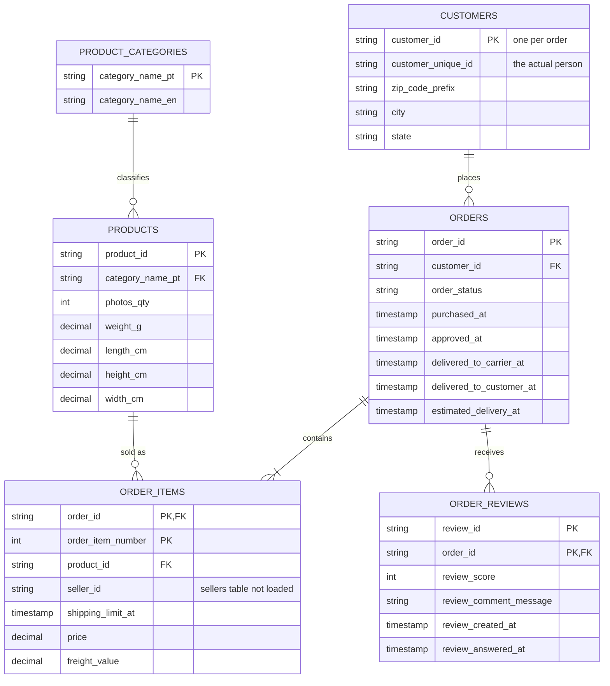
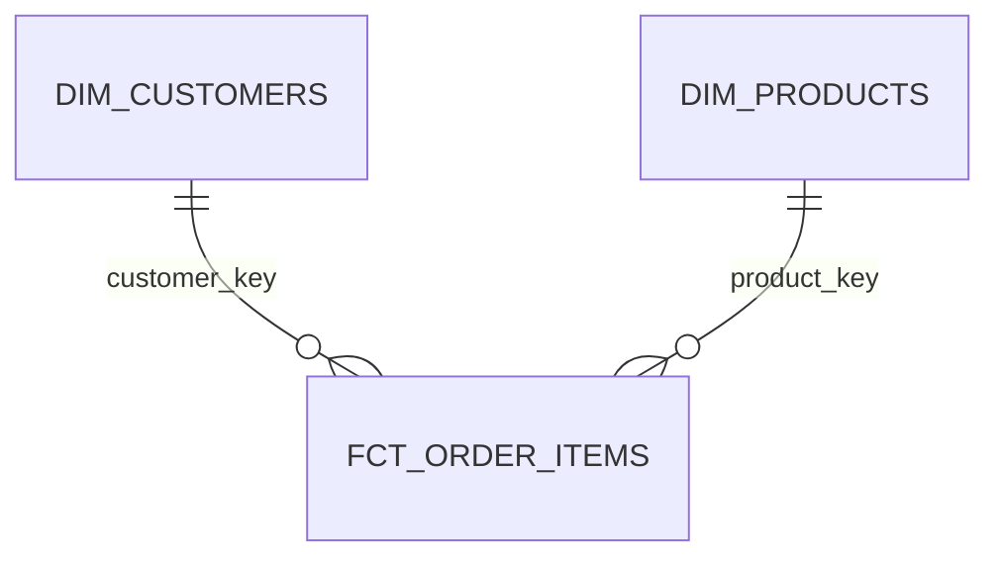

# Data model

## 3NF model of the conformed (staging) layer

## Normalisation reasoning

Each entity holds attributes that depend only on its own key: order facts live in ORDERS, line-level facts in ORDER_ITEMS, product attributes in PRODUCTS, and the Portuguese to English category names are split out into PRODUCT_CATEGORIES so a translation is stored once rather than on every product. The many-to-many relationship between orders and products is resolved by ORDER_ITEMS, an associative table keyed by (order_id, order_item_number). Reviews are one-to-many from orders (547 orders have more than one review), and because review_id alone is not unique in the source, REVIEWS is keyed by (review_id, order_id). I deliberately break 3NF in CUSTOMERS: city and state depend on zip_code_prefix rather than on the key, but no clean zip reference table is loaded, so I keep them on the customer row. Another quirk is that customer_id is generated per order, so the real person is customer_unique_id, which is why the mart dimension is built on that instead.

## Star schema in marts

I normalise in staging so cleaning and deduplication happen once, on entities with clear keys, and denormalise into a star schema in marts because analysts then answer questions with one join to a dimension and no multi-hop joins. The fact table (`fct_order_items`) is at order-item grain, carries the numeric measures (price, freight, delivery days) and a date, and is linked to the dimensions by surrogate key.

## Keys, constraints and duplicates

- **Surrogate keys:** `dbt_utils.generate_surrogate_key` (a hash of the natural key) for `customer_key`, `product_key`, `order_item_key` and `review_key`. Natural keys are kept alongside.
- **Duplicates:** staging models dedupe with `QUALIFY ROW_NUMBER()`, keeping the latest loaded row per natural key.
- **Constraints:** Snowflake does not enforce primary, unique or foreign keys on standard tables, so integrity is enforced by dbt tests (`unique`, `not_null`, `relationships`) on every key. `dbt build` fails if a key is duplicated or a foreign key has no parent.

## Materialisation

| Layer | Schema | Materialisation | Why |
|---|---|---|---|
| Raw | `OLIST.RAW` | Tables (loaded with `COPY INTO`) | Kept as loaded, all VARCHAR plus load metadata |
| Staging | `OLIST.STAGING` | Views | Light cleaning only, cheap to rebuild, always reflects raw |
| Marts | `OLIST.MARTS` | Tables | Queried most, so precomputing joins is faster and cheaper |

Evidence: see `+materialized` and `+schema` in `dbt_project/dbt_project.yml`. With larger data, `fct_order_items` would become incremental (merge on `order_item_key`).
